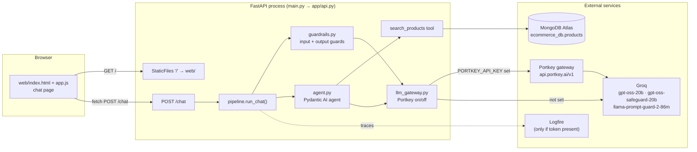
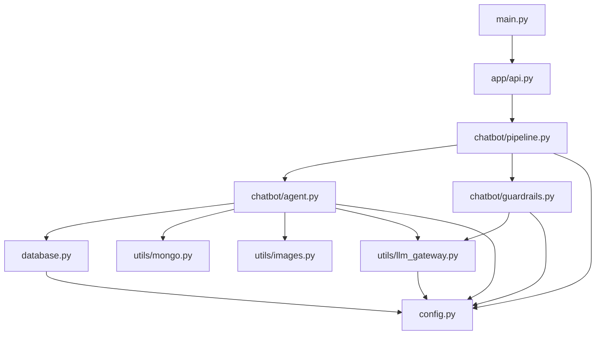
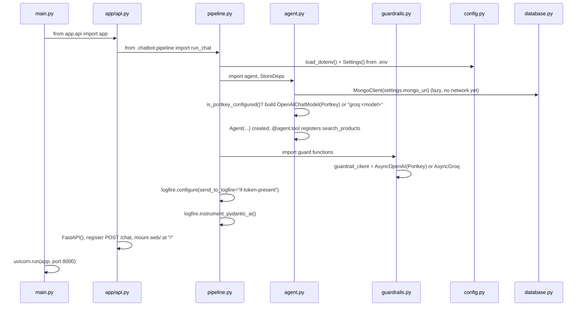
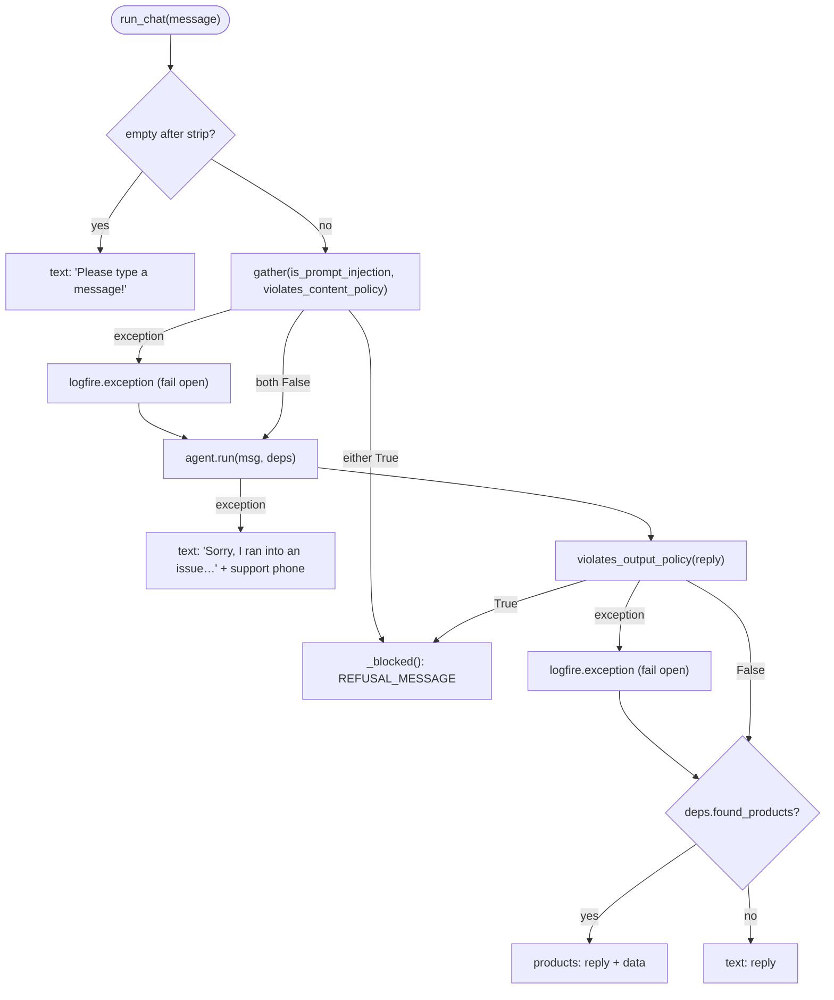
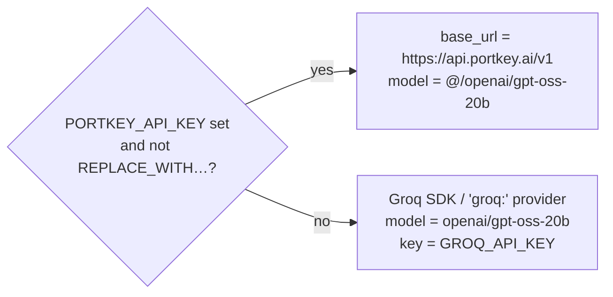
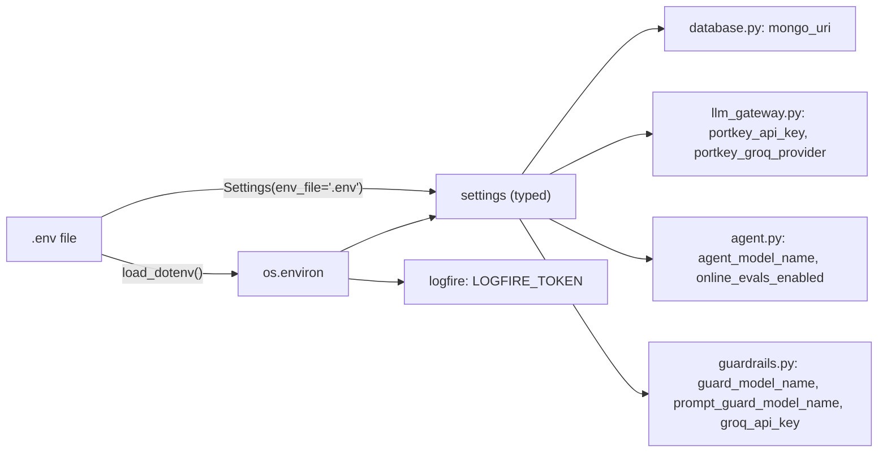
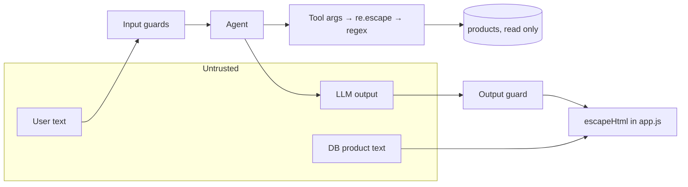

# LUXE Shopping Assistant POC: Architecture and Code Flow

This document explains how the POC in this folder is put together and what happens,
line by line, when a customer sends a chat message. For the concepts behind it
(MongoDB, ReAct agents, guardrails), see [`POC_DEVELOPMENT_NOTES.md`](POC_DEVELOPMENT_NOTES.md).

## Contents

1. [What the POC is](#1-what-the-poc-is)
2. [System architecture](#2-system-architecture)
3. [Folder layout and module roles](#3-folder-layout-and-module-roles)
4. [Startup flow (import time)](#4-startup-flow-import-time)
5. [Request flow: one chat message end to end](#5-request-flow-one-chat-message-end-to-end)
6. [Component deep dives](#6-component-deep-dives)
7. [Data contracts](#7-data-contracts)
8. [Error handling and failure modes](#8-error-handling-and-failure-modes)
9. [Configuration resolution](#9-configuration-resolution)
10. [Security boundaries](#10-security-boundaries)
11. [Testing hooks](#11-testing-hooks)

---

## 1. What the POC is

A small FastAPI service with **one endpoint**, `POST /chat`, and **one static page**.
A customer types a shopping question. The service screens the message with safety
guardrails, lets a Pydantic AI agent search the client's MongoDB product catalog,
screens the reply again, and returns either text or a list of products.

The POC runs separately from the client's store. It only **reads** the existing
`ecommerce_db.products` collection and never writes anything.

---

## 2. System architecture



**Layers**

| Layer          | Responsibility                                       | Files                                                                |
| -------------- | ---------------------------------------------------- | -------------------------------------------------------------------- |
| Presentation   | Chat page; renders text bubbles or product cards     | `web/index.html`, `web/app.js`                                   |
| HTTP           | One route plus static file serving                   | `main.py`, `app/api.py`                                          |
| Orchestration  | Order of operations, fail-open logic, response shape | `app/chatbot/pipeline.py`                                          |
| Safety         | Injection and policy checks on input and output      | `app/chatbot/guardrails.py`                                        |
| Reasoning      | LLM agent, system prompt, tool                       | `app/chatbot/agent.py`                                             |
| Data access    | Read-only Mongo handle, query helpers, image shaping | `app/database.py`, `app/utils/mongo.py`, `app/utils/images.py` |
| Infrastructure | Settings, LLM routing                                | `app/config.py`, `app/utils/llm_gateway.py`                      |

---

## 3. Folder layout and module roles

```text
02_POC Development CODE/
├── main.py                     # entry point: uvicorn on :8000
├── requirements.txt
├── app/
│   ├── api.py                  # FastAPI app: POST /chat + static web/
│   ├── config.py               # Settings (pydantic-settings), REFUSAL_MESSAGE
│   ├── database.py             # MongoClient → products_collection (only)
│   ├── chatbot/
│   │   ├── pipeline.py         # run_chat(): guards → agent → guard → dict
│   │   ├── agent.py            # Agent, SYSTEM_PROMPT, StoreDeps, search_products
│   │   └── guardrails.py       # Prompt Guard 2 + safeguard policies
│   └── utils/
│       ├── llm_gateway.py      # Portkey detection + model-name rewriting
│       ├── mongo.py            # regex/price query fragments, plural handling
│       ├── images.py           # base64 → data: URL
│       └── test_mongo.py       # self-check for keyword_contains
├── web/
│   ├── index.html              # chat page markup + CSS
│   └── app.js                  # send/render loop
└── experiments/
    ├── 01_mongo_db.ipynb       # PyMongo CRUD practice
    ├── pydantic_experiments.ipynb
    └── guardrail_check.py      # runs each guard on its own
```

### Import graph

Arrows read "imports". `config.py` sits at the bottom and is imported by everything.



---

## 4. Startup flow (import time)

Most setup happens **when modules are imported**, before the first request
arrives. Running `python main.py` (or `uvicorn main:app`) triggers this chain:



Points to know:

- **`.env` is read once**, in [`app/config.py`](app/config.py#L19). Changing `.env` needs a server restart.
- **Portkey vs direct Groq is decided once at import.** Both the agent model
  ([`agent.py:54`](app/chatbot/agent.py#L54)) and the guardrail client
  ([`guardrails.py:32`](app/chatbot/guardrails.py#L32)) are built at import time.
- **MongoDB does not connect at startup.** `MongoClient` connects lazily, so a bad
  `MONGO_URI` only shows up on the first product search.
- **Logfire stays quiet without a token**, because of `send_to_logfire="if-token-present"`.
  Without that argument, the import fails with `LogfireConfigError`.

---

## 5. Request flow: one chat message end to end

Example message: **"show me men shirts under 2000"**.

```mermaid
sequenceDiagram
    autonumber
    actor U as Customer
    participant JS as web/app.js
    participant API as api.chat()
    participant RC as pipeline.run_chat()
    participant PG as Prompt Guard 2
    participant SG as Safeguard 20b
    participant AG as Agent (gpt-oss-20b)
    participant T as search_products()
    participant DB as MongoDB

    U->>JS: types message, submit
    JS->>JS: messages.push(user), loading=true, render()
    JS->>API: POST /chat {"message": "..."}
    API->>RC: run_chat(data.get("message", ""))
    RC->>RC: strip(); empty → "Please type a message!"
    par input guards (asyncio.gather)
        RC->>PG: is_prompt_injection(msg)
        PG-->>RC: score "0.01" → False
    and
        RC->>SG: violates_content_policy(msg) with INPUT_POLICY
        SG-->>RC: {"violation": 0} → False
    end
    RC->>AG: agent.run(msg, deps=StoreDeps())
    AG->>AG: Think: shopping request → call tool
    AG->>T: search_products(category="men", keyword="shirts", max_price=2000)
    T->>DB: find({category: /^men$/i, name: /shirt/i, price: {$lte: 2000}}).limit(8)
    DB-->>T: documents
    T->>T: _id→id, resolve_image_field(), ctx.deps.found_products = [...]
    T-->>AG: "Found 1 products matching the request."
    AG-->>RC: result.output = "Here are men's shirts under ₹2000!"
    RC->>SG: violates_output_policy(reply) with OUTPUT_POLICY
    SG-->>RC: {"violation": 0} → False
    RC-->>API: {"type": "products", "message": ..., "data": [...]}
    API-->>JS: JSON
    JS->>JS: messages.push(bot), loading=false, render() → product cards
```

### Step-by-step with code locations

| #  | What happens                                                                                         | Where                                                                             |
| -- | ---------------------------------------------------------------------------------------------------- | --------------------------------------------------------------------------------- |
| 1  | The form submit handler trims the input, ignores it if empty or still loading, then calls `send()` | `web/app.js` (form `submit` listener)                                         |
| 2  | `send()` pushes the user bubble, shows "Typing…", POSTs JSON to `/chat`                         | `web/app.js` `send()`                                                         |
| 3  | FastAPI hands the body to `run_chat`                                                               | [`app/api.py:16`](app/api.py#L16)                                                |
| 4  | Empty message → early reply                                                                         | [`pipeline.py:33`](app/chatbot/pipeline.py#L33)                                  |
| 5  | **Input guards** run in parallel; either flag → `_blocked()` refusal                        | [`pipeline.py:39`](app/chatbot/pipeline.py#L39)                                  |
| 6  | Fresh `StoreDeps()` per request; **agent run**                                               | [`pipeline.py:50`](app/chatbot/pipeline.py#L50)                                  |
| 7  | Tool builds the Mongo filter from the LLM's arguments                                                | [`agent.py:112`](app/chatbot/agent.py#L112)–[`115`](app/chatbot/agent.py#L115) |
| 8  | Query, capped at 8 results                                                                           | [`agent.py:121`](app/chatbot/agent.py#L121)                                      |
| 9  | Results shaped and stored on `ctx.deps`; the LLM gets only a count string                          | [`agent.py:131`](app/chatbot/agent.py#L131)                                      |
| 10 | **Output guard** on the reply text; flagged → `_blocked()`                                  | [`pipeline.py:56`](app/chatbot/pipeline.py#L56)                                  |
| 11 | `found_products` non-empty → `type: "products"`, else `type: "text"`                          | [`pipeline.py:61`](app/chatbot/pipeline.py#L61)                                  |
| 12 | `renderMessage()` draws cards (escaped HTML) or a text bubble                                      | `web/app.js` `renderMessage()`                                                |

### Decision flow inside `run_chat`



---

## 6. Component deep dives

### 6.1 `app/api.py`: HTTP layer

- `FastAPI(title="LUXE Shopping Assistant — POC")`.
- `POST /chat` takes a raw `dict` body (no Pydantic model) and returns whatever
  `run_chat` returns.
- `app.mount("/", StaticFiles(directory="web", html=True))` is registered **after**
  the route, so `/chat` is matched first and every other path serves files from `web/`.

### 6.2 `app/chatbot/pipeline.py`: orchestrator

- Holds all the ordering logic, so the HTTP layer stays trivial. The same
  function backs `POST /chat` in `03_FINAL INTEGRATION`.
- **Never raises.** Every branch returns the `{"type", "message", "data"}` dict.
- Creates a **new `StoreDeps` per request**, so one customer's results can never
  leak into another customer's reply.

### 6.3 `app/chatbot/agent.py`: the agent

| Piece                           | Purpose                                                                                                                    |
| ------------------------------- | -------------------------------------------------------------------------------------------------------------------------- |
| `SYSTEM_PROMPT`               | Persona + 5 rules: greet, always search for product questions, confirm the search, refuse off-topic, never invent products |
| `StoreDeps`                   | Per-run side channel: `found_products: list[dict]`                                                                       |
| `agent_model`                 | `OpenAIChatModel` pointed at Portkey, or the string `"groq:openai/gpt-oss-20b"`                                        |
| `_capabilities`               | Empty in the POC; `03` can attach online evals                                                                           |
| `Agent(...)`                  | `name="luxe-chatbot"`, `deps_type=StoreDeps`                                                                           |
| `@agent.tool search_products` | The only tool. Its docstring and type hints become the JSON schema the LLM sees.                                           |

**Why the tool returns a string and not the products:** the LLM only needs to know
*whether* something was found, so it can phrase the reply. Returning full
documents, including base64 images, would cost many tokens and invite the
model to restate prices or names, which can introduce mistakes. The real data
goes straight to the UI through `ctx.deps`.

### 6.4 `app/chatbot/guardrails.py`: safety

| Function                    | Model                                   | Input                                 | Decision                                                                   |
| --------------------------- | --------------------------------------- | ------------------------------------- | -------------------------------------------------------------------------- |
| `is_prompt_injection`     | `meta-llama/llama-prompt-guard-2-86m` | raw user text                         | reply parsed as a float; `≥ 0.5` → injection; unparseable → `False` |
| `violates_content_policy` | `openai/gpt-oss-safeguard-20b`        | `INPUT_POLICY` (system) + user text | JSON `violation` field                                                   |
| `violates_output_policy`  | same model                              | `OUTPUT_POLICY` + agent reply       | JSON `violation` field                                                   |

`_check_safety` strips any `` ```json `` fences, parses the JSON, and treats a
parse failure as **safe** (`False`). It calls the model with `reasoning_effort="low"`.

### 6.5 `app/utils/llm_gateway.py`: routing



`PORTKEY_GROQ_PROVIDER` may be written `clothing` or `@clothing`; the code strips
a leading `@` and adds it back when it builds the model name.

### 6.6 Data access: `database.py`, `utils/mongo.py`, `utils/images.py`

- `database.py` exposes **only** `products_collection` from `ecommerce_db`.
- `utils/mongo.py` builds query fragments:
  - `case_insensitive_exact("men")` → `{"$regex": "^men$", "$options": "i"}`. This
    handles the mixed `Men`/`men` category values in the data.
  - `keyword_contains("polo shirts")` → stems each word (`shirts`→`shirt`) and then
    builds a `re.escape`d case-insensitive substring match.
  - `price_range_filter(min, max)` → `{"$gte": …, "$lte": …}`, or `{}` if neither is given.
- `utils/images.py` `resolve_image_field(doc)` keeps an `http(s)` `image` URL, or
  builds `data:<type>;base64,<data>` from `image_data`. Either way, it removes the raw
  base64 fields.

### 6.7 `web/app.js`: client

- Keeps state in memory (`messages[]`, `loading`). Every change re-renders the whole list.
- Escapes every value with `escapeHtml` before inserting HTML. Product names come
  from the DB and the reply comes from an LLM, so both are treated as untrusted.
- If `fetch` fails (network error), it shows a local fallback bubble.

---

## 7. Data contracts

**Request**

```json
POST /chat
{ "message": "show me men shirts under 2000" }
```

**Response**: always one of:

```json
{ "type": "text", "message": "Hi! How can I help?", "data": null }
```

```json
{
  "type": "products",
  "message": "Here are men's shirts under ₹2000!",
  "data": [
    {
      "id": "<24-hex ObjectId string>",
      "name": "Striped Polo Shirt",
      "description": "…",
      "price": 699,
      "category": "men",
      "size": ["M", "L"],
      "color": ["…"],
      "image": "data:image/jpeg;base64,…"
    }
  ]
}
```

**Tool schema the LLM sees** (generated from the `search_products` signature and docstring):

| Arg           | Type           | Meaning                        |
| ------------- | -------------- | ------------------------------ |
| `category`  | `str \| None` | `men`, `women` or `kids` |
| `keyword`   | `str \| None` | word in the product name       |
| `max_price` | `int \| None` | upper bound in ₹              |
| `min_price` | `int \| None` | lower bound in ₹              |

---

## 8. Error handling and failure modes

| Failure                                    | Where it is caught                          | User sees                               | Logged                                         |
| ------------------------------------------ | ------------------------------------------- | --------------------------------------- | ---------------------------------------------- |
| Empty message                              | `run_chat`                                | "Please type a message!"                | no                                             |
| Guard flags input                          | `run_chat`                                | `REFUSAL_MESSAGE`                     | `logfire.warn` with rationale (policy guard) |
| Guard **call** errors (timeout, 5xx) | `run_chat` `except`                     | request continues (**fail open**) | `logfire.exception`                          |
| Guard returns unparseable text             | `is_prompt_injection` / `_check_safety` | treated as safe                         | no                                             |
| Agent / LLM / Mongo error                  | `run_chat` outer `except`               | "Sorry, I ran into an issue…" + phone  | `logfire.exception`                          |
| Output guard flags reply                   | `run_chat`                                | `REFUSAL_MESSAGE`                     | `logfire.warn`                               |
| Output guard call errors                   | `run_chat` inner `except`               | original reply (**fail open**)    | `logfire.exception`                          |
| Network failure in browser                 | `web/app.js` `catch`                    | "Sorry, something went wrong…"         | browser console only                           |

**Fail-open trade-off:** a guard outage never takes chat down, but during
the outage messages go unscreened. To fail closed instead, return `_blocked()` in
the two `except` blocks around the guard calls.

---

## 9. Configuration resolution



| Variable                    | Default                                 | Read by                                                           |
| --------------------------- | --------------------------------------- | ----------------------------------------------------------------- |
| `MONGO_URI`               | none                                    | `database.py`                                                   |
| `GROQ_API_KEY`            | none                                    | `guardrails.py` (`AsyncGroq`), Pydantic AI `groq:` provider |
| `PORTKEY_API_KEY`         | `""`                                  | `llm_gateway.py`                                                |
| `PORTKEY_GROQ_PROVIDER`   | `groq`                                | `llm_gateway.py`                                                |
| `AGENT_MODEL_NAME`        | `openai/gpt-oss-20b`                  | `agent.py`                                                      |
| `GUARD_MODEL_NAME`        | `openai/gpt-oss-safeguard-20b`        | `guardrails.py`                                                 |
| `PROMPT_GUARD_MODEL_NAME` | `meta-llama/llama-prompt-guard-2-86m` | `guardrails.py`                                                 |
| `ONLINE_EVALS_ENABLED`    | `false`                               | `agent.py`                                                      |
| `LOGFIRE_TOKEN`           | none                                    | Logfire SDK directly (not `Settings`)                           |

Variable names are case-insensitive, and unknown keys in `.env` are ignored (`extra="ignore"`).

---

## 10. Security boundaries



| Boundary            | Control                                                                                                         |
| ------------------- | --------------------------------------------------------------------------------------------------------------- |
| User → LLM         | Prompt Guard 2 + policy guard; system-prompt rules                                                              |
| LLM → database     | Only one tool; the LLM chooses **filter values**, never raw queries; `re.escape` on text; `.limit(8)` |
| Database scope      | Only the `products` handle exists in the process; no `users`, `orders`, `cart`                          |
| LLM → user         | Output policy guard                                                                                             |
| Any text → browser | `escapeHtml` on every interpolated value (blocks XSS from DB or LLM text)                                     |
| Secrets             | `.env` only, git-ignored; Portkey can hold the Groq key so the app never sees it                              |

Not covered by the POC: authentication, rate limiting, per-user quotas,
and multi-turn memory (each request is stateless).

---

## 11. Testing hooks

| Check                           | Command (from this folder)                                                                                   | Live calls?    |
| ------------------------------- | ------------------------------------------------------------------------------------------------------------ | -------------- |
| Keyword/plural helper           | `python -m app.utils.test_mongo`                                                                           | no             |
| Each guardrail separately       | `python -m experiments.guardrail_check`                                                                    | yes (LLM)      |
| Whole pipeline                  | `curl -s localhost:8000/chat -H 'content-type: application/json' -d '{"message":"men shirts under 2000"}'` | yes (LLM + DB) |
| Which tool args the agent chose | `agent.run(...)`, then inspect `result.all_messages()` for `tool-call` parts                           | yes            |

The offline eval suite (`python -m backend.evals.chatbot_evals`) exists only in
`03_FINAL INTEGRATION`.
