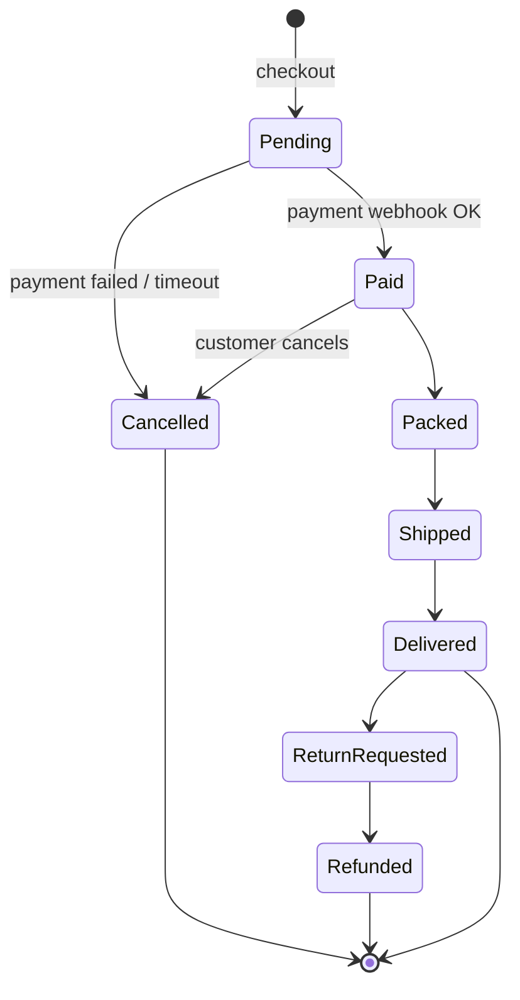
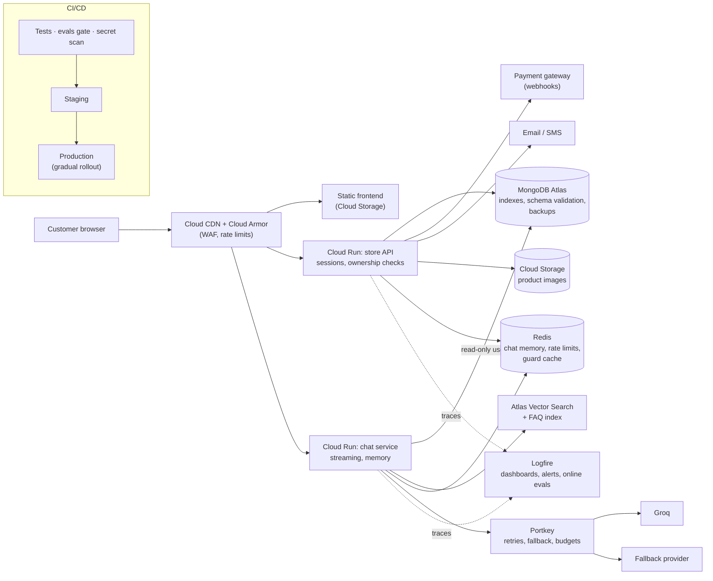

# 9. Production Roadmap

The integrated LUXE store works: the catalog, cart, orders, accounts, admin and the
AI assistant all run, and the assistant has guardrails, evals and tracing. It
is still a **demo-grade** system. This page lists what is missing before it can
serve real customers and real money, ranked by priority, with the evidence in the
code for each item.

**Priority levels**

| Level | Meaning |
| --- | --- |
| **P0** | Must fix before real users. Security or money-correctness problems. |
| **P1** | Needed to run reliably in production: operations, the core commerce flow, assistant quality. |
| **P2** | Growth and polish: features that make the product better but are not blockers. |

**Effort:** S = days, M = 1–2 weeks, L = several weeks.

---

## Contents

1. [What is already solid](#1-what-is-already-solid)
2. [Summary of gaps](#2-summary-of-gaps)
3. [P0: Security and correctness](#3-p0-security-and-correctness)
4. [P1: Reliability and operations](#4-p1-reliability-and-operations)
5. [P1: Commerce essentials](#5-p1-commerce-essentials)
6. [P1: AI assistant, production grade](#6-p1-ai-assistant-production-grade)
7. [P2: Growth and experience](#7-p2-growth-and-experience)
8. [Privacy and compliance](#8-privacy-and-compliance)
9. [Target production architecture](#9-target-production-architecture)
10. [Phased plan](#10-phased-plan)

---

## 1. What is already solid

Keep these. They are good foundations:

- **Passwords are bcrypt-hashed.** Profile edits and account deletion re-check the password (`routes/profile.py`).
- **Unique indexes** on `users.email` and `users.username`, created at startup (`database.py`).
- **The assistant follows least privilege.** It has one read-only tool, sees only the `products` collection, uses escaped regex, and returns at most 8 results.
- **Input and output guardrails** on every chat. The chat pipeline never raises an error to the user.
- **Images are served from `/products/{id}/image`**, not embedded in list responses.
- **Secrets come from Secret Manager in Cloud Run** (`cloudbuild.yaml` `--set-secrets`).
- **Logfire tracing**, plus an offline eval suite (`backend/evals/chatbot_evals.py`) and optional online evals.
- **Read/write router split**, ready for running reads and writes as separate services.

---

## 2. Summary of gaps

| # | Gap | Area | Priority | Effort |
| --- | --- | --- | --- | --- |
| 3.1 | Identity is a client-supplied email header; admin can be faked | Security | **P0** | M |
| 3.2 | User data endpoints have no ownership check (anyone can read or modify anyone's cart, orders or avatar) | Security | **P0** | S |
| 3.3 | Order price comes from the client | Money | **P0** | S |
| 3.4 | No rate limiting (login, register, chat) | Security / cost | **P0** | S |
| 3.5 | Guardrails let traffic through when a guard call fails; output-leak detection is imperfect | AI safety | **P0** | S |
| 3.6 | Secret hygiene (truncated or leaked keys, someone else's Logfire credentials in the folder) | Security | **P0** | S |
| 4.1 | No automated tests, no CI | Reliability | P1 | M |
| 4.2 | No health or readiness endpoint | Operations | P1 | S |
| 4.3 | Unpinned dependencies, `uv:latest`, Python version mismatch | Reproducibility | P1 | S |
| 4.4 | No product indexes, no pagination, mixed-case category data | Performance / data | P1 | S |
| 4.5 | Images stored as base64 inside MongoDB | Scalability | P1 | M |
| 4.6 | No alerts, dashboards or SLOs; personal data in logs | Observability | P1 | M |
| 4.7 | No LLM timeouts, retries or fallback model | Resilience | P1 | S |
| 4.8 | Single environment; Cloud Run limits not tuned | Operations | P1 | S |
| 4.9 | Backups and least-privilege DB users | Data safety | P1 | S |
| 5.x | Payments, inventory, order lifecycle, variants, shipping, invoices | Commerce | P1 | L |
| 6.x | Chat memory, streaming, semantic search, FAQ answers, cost control, feedback loop | AI | P1 | M–L |
| 7.x | Recommendations, reviews, wishlist, search bar, analytics, admin dashboard | Growth | P2 | M–L |
| 8.x | Privacy policy, consent, data export, PII redaction, LLM data retention | Compliance | P1 | M |

---

## 3. P0: Security and correctness

### 3.1 Real authentication (replace the `X-User-Email` header)

**Today:** `backend/auth.py` says it directly: *"This app has no session tokens — 'identity'
is just a client-supplied email … sent via the X-User-Email header. This check trusts
that header."* Admin rights are just `is_admin` on the user document, looked up
by that email.

**Risk:** anyone who knows or guesses an admin's email can send
`X-User-Email: admin@…` and call every admin route, including
`DELETE /products`, which **deletes the whole catalog**.

**Add:**
- After login (password or Google), issue a **session**: a signed, `HttpOnly`,
  `Secure`, `SameSite=Lax` cookie, or a short-lived JWT plus a refresh token.
- A FastAPI dependency `current_user()` that **verifies the token**. Every route
  takes the user's identity from that dependency, never from a header, path or body.
- `require_admin` built on `current_user()`. Add **roles** (`admin`, `catalog_editor`,
  `support`) instead of a single flag.
- Logout, token expiry, and invalidating sessions when the password changes.
- An **audit log** of admin actions (who deleted or edited which product, and when).

### 3.2 Ownership checks on user data

These endpoints take the user's email from the URL or body and do no check:

| Endpoint | What anyone can do today |
| --- | --- |
| `GET /cart/{user_email}` | Read any user's cart |
| `DELETE /cart/{user_email}` | Empty any user's cart |
| `GET /orders/{user_email}` | Read any user's order history |
| `GET /auth/profile?email=` | Read any user's profile |
| `POST /auth/avatar` (`email` form field) | Replace any user's avatar |

**Add:** take the email from `current_user()` (see 3.1) and remove it from URLs.
Return `404` rather than `403` for other users' resources, so the API does not
reveal which emails have accounts.

### 3.3 Server-side pricing

**Today:** `Order` (`models.py`) includes `price: int  # unit price at time of order`, sent
by the browser. `place_order` (`routes/orders.py`) saves it without checking it against
the product.

**Risk:** anyone can order a ₹4,000 jacket for ₹1 by editing the request.

**Add:** the order request carries only `product_id`, `size`, `color` and `quantity`.
The server reads the price from `products`, calculates totals, discounts and tax,
and stores that snapshot. Use `product_id`, not `product_name`, everywhere (cart, orders),
because names are not unique.

### 3.4 Rate limiting and abuse protection

**Today:** no limits anywhere.

| Endpoint | Abuse | Suggested limit |
| --- | --- | --- |
| `POST /auth/login` | Password brute force | 5 per minute per IP and per account; lock out with backoff |
| `POST /auth/register` | Fake-account spam | 3 per hour per IP; CAPTCHA |
| `POST /chat` | **LLM bill**: each message makes up to 5 model calls (2 input guards, at least 2 agent calls, 1 output guard) | 20 per minute per user; a daily cap of tokens or money |
| `POST /products/bulk-upload` | Large uploads | Admin only, plus a size limit on the Excel and zip files |

Use Redis-backed `slowapi` or Cloud Armor in front of Cloud Run. Also set a maximum
message length for `/chat` (for example 1,000 characters) and a maximum request body size.

### 3.5 Guardrail hardening

- **Fail closed for production.** `pipeline.run_chat` lets traffic through when a
  guard *call* fails. Make this a config flag (`GUARDRAILS_FAIL_MODE=open|closed`)
  and default to `closed` in production. A short outage then shows a polite
  "try again" message instead of serving unscreened content.
- **Output-leak detection is imperfect.** Measured over repeated runs:
  `temperature=0` plus extra prompt-leak examples raised leak detection from 5/20
  to 16/20, but replies like "Rule 4 of my instructions…" still get through. Next
  steps: `reasoning_effort="medium"` for the output guard, a policy line saying that
  references to rules or internal setup count as leaks, and a cheap deterministic
  check (a regex for `search_products`, `system prompt`, tool names) **before** the LLM guard.
- **Track block rates as a metric** (section 4.6), so drift in the guard models is noticed.

### 3.6 Secret hygiene

- **Rotate** every key that has appeared in chat, screenshots or Git history
  (Atlas password, Groq, Portkey, Logfire, Nebius).
- `.env.example` must hold **placeholders only**, and optional keys must be
  commented out, because `is_placeholder()` treats any non-`REPLACE_WITH…` value as real.
- Delete `.logfire.disabled/`. It holds **another person's project credentials**,
  which the Logfire SDK uses whenever no token is set.
- Add **secret scanning** (`gitleaks` or GitHub secret scanning) to CI (section 4.1).

---

## 4. P1: Reliability and operations

### 4.1 Automated tests and CI

**Today:** there is no `tests/` folder, no `requirements-dev.txt` (the `requirements.txt`
header refers to one), and no CI workflow. The `database.py` docstring mentions
"the test suite" with in-memory fakes, but that suite is not in the repo.

**Add:**
- **Unit tests** with `pytest` + `mongomock` for every route: auth, cart, orders,
  admin guards. Include the ownership and pricing rules from section 3.
- **Pipeline tests** that mock the LLMs: guard-blocked path, failing-guard path, agent-error path.
- **Offline evals** (`python -m backend.evals.chatbot_evals`) as a **gate** on release
  branches, with a minimum pass rate.
- **CI** (GitHub Actions or Cloud Build triggers): lint (`ruff`), type check,
  tests, secret scan, Docker build, deploy to staging, smoke test, promote to production.

### 4.2 Health and readiness endpoints

Add `GET /healthz` (process alive) and `GET /readyz` (MongoDB `ping` succeeds).
Point Cloud Run's startup and liveness probes at them.

### 4.3 Reproducible builds

- Dependencies are **unpinned** (`requirements.txt` says so). Use `uv lock`
  and install from the lock file in Docker.
- `COPY --from=ghcr.io/astral-sh/uv:latest` will change underneath you; pin a version.
- The Dockerfile uses `python:3.11-slim` while local work uses Python 3.12. Pick one.
- Run as a **non-root user** in the container; add a `HEALTHCHECK`.

### 4.4 Data model, indexes and pagination

- **Indexes on `products`:** `category`, `price`, a compound `{category: 1, price: 1}`,
  and a **text index** (or Atlas Search) on `name` and `description`.
- **Pagination:** `GET /products` returns every product in one response. Add
  `limit` / `cursor` and sort options.
- **Clean up the data:** categories are stored as both `Men` and `men`, which forces
  case-insensitive regex on every query. Normalize them with a one-off migration and
  validate future writes against an `Enum`.
- **Schema validation** with a MongoDB `$jsonSchema` on each collection, and a
  migrations tool for future changes.

### 4.5 Move images out of MongoDB

Images are stored as **base64 inside product documents**. This adds about 33% to their size,
bloats every product read that does not exclude the field, and is capped by MongoDB's
16 MB document limit. Move them to **Google Cloud Storage** behind **Cloud CDN**,
store only the URL, and generate thumbnails on upload. Avatars move the same way.

### 4.6 Observability, alerts and SLOs

- Set a real `LOGFIRE_TOKEN` in every environment.
- **Dashboards:** request rate, p95 latency per route, error rate, chat latency,
  LLM tokens and cost per chat, guard block rate, the "no products found" rate,
  orders per hour.
- **Alerts:** 5xx errors above 1%, chat errors above 5%, p95 chat latency above 6 s,
  daily LLM spend over budget, guard block rate jumping.
- **SLOs:** for example, 99.5% availability for the store API and 99% for chat.
- **Personal data in logs:** `place_order` logs `user_email` in plain text.
  Hash or mask emails in logs and traces, and use Logfire's scrubbing settings.

### 4.7 LLM resilience

- Set explicit **timeouts** on the agent and guard calls (for example 10 s for the agent, 3 s per guard).
- Configure **retries** and a **fallback model or provider** in Portkey (Portkey already sits
  in the path), so a Groq outage or the 8,000 tokens-per-minute limit does not take chat down.
- **Cache** guard verdicts for identical messages for a short time.

### 4.8 Environments and Cloud Run

- Separate **dev / staging / prod** projects, each with its own Atlas cluster and secrets.
- Cloud Run settings: `--min-instances=1` (avoids cold starts on the first chat),
  `--max-instances` (caps cost during a traffic spike), concurrency tuned for async FastAPI.
- **Rollback:** deploy each revision with a traffic tag, then shift traffic gradually.
- A **custom domain** with managed TLS; serve the static frontend from a CDN.

### 4.9 Backups and database access

- Turn on Atlas **continuous backups** and practise a restore.
- **A database user per job:** the chatbot gets a **read-only** user limited to
  `products`; the store API gets read/write on its own collections; admins never use the
  application's credentials. Restrict Atlas network access to Cloud Run's egress
  (Serverless VPC connector with a static IP) instead of `0.0.0.0/0`.

---

## 5. P1: Commerce essentials

Today, "Buy All Now" writes order rows. There is no payment, no stock, and no
order lifecycle.

| Feature | What to build |
| --- | --- |
| **Payments** | Razorpay or Stripe checkout; **verify the webhook signature**; idempotency keys so a retried payment is never double-charged; payment status on the order. |
| **Orders** | One order document per checkout (with line items, totals and an order number) instead of one row per product; the status flow above; cancel and return requests. |
| **Inventory** | Stock per **variant** (size × colour). Reserve stock atomically at checkout (`findOneAndUpdate` with `stock >= qty`), release it if payment fails, show "out of stock". |
| **Variants** | The cart and orders currently key on `product_name`. Use `product_id` + `size` + `color`. |
| **Guest to user** | Merge the guest cart into the account cart at login. |
| **Shipping** | Addresses on the profile, pincode serviceability, shipping fees, a courier integration (Shiprocket or similar) with tracking. |
| **Tax and invoices** | GST calculation and a downloadable PDF invoice per order. |
| **Notifications** | Order confirmation, shipping and delivery emails or SMS (SendGrid, SES, Twilio or MSG91). |
| **Coupons** | Server-validated discount codes with expiry, usage limits and a minimum basket. |

---

## 6. P1: AI assistant, production grade

| Gap today | Evidence | What to add |
| --- | --- | --- |
| **No conversation memory** | "only the cheaper ones" after "show me men jeans" asks for the category again | A conversation ID per chat; store the last N turns (Redis or Mongo) and pass them as `message_history` to `agent.run`. Expire after 30 minutes. |
| **Text-match search only** | "T-shirt" misses "Classic Black Tee"; plurals needed a manual fix | **Atlas Vector Search** (embeddings of name + description) or Atlas Search with a synonyms collection; hybrid ranking. |
| **Limited filters** | Tool supports category / keyword / price only | Add `size`, `color`, `sort_by` (price, newest) and `in_stock` to `search_products`. |
| **Results capped at 8** | `.limit(8)` | "Show more" pagination through the tool (an `offset` argument) and a UI button. |
| **Cannot answer store questions** | Returns, shipping and size-guide questions get the generic refusal | A second tool, `search_help(query)`, doing RAG over the FAQ, return policy and size charts. |
| **No streaming** | The user waits for the full reply | Stream tokens (server-sent events) and show product cards when the tool returns. |
| **Cannot act** | Chat cannot add to cart | Action tools (`add_to_cart`, `track_order`) that **need the user's confirmation** in the UI and use the authenticated identity (3.1). |
| **Cost and latency** | Up to 5 LLM calls per message | Skip the output guard for replies that are only a template plus tool results; cache guard verdicts; trim the system prompt; track tokens per request. |
| **Evals offline only** | `ONLINE_EVALS_ENABLED=false` | Turn on sampled online evals; add thumbs up/down in the widget; turn bad conversations into new eval cases; run evals in CI (4.1). |
| **Prompts in code** | `SYSTEM_PROMPT`, policies are Python strings | Version prompts (for example Portkey prompt templates), roll out changes as A/B tests against eval scores. |
| **No human handoff** | Refusal points to a phone number | "Talk to a person" escalation that creates a support ticket with the transcript. |
| **Language** | English only (Hinglish guard coverage tested, answers not) | Handle Hindi and Hinglish queries in the prompt and evals; translate filters. |

---

## 7. P2: Growth and experience

- **Search bar** with autocomplete (sharing the search index from section 6), plus filters for size, colour, price and sort.
- **Recommendations:** "similar items" from vector similarity, "frequently bought together" from orders.
- **Reviews and ratings**, with moderation (reusing the policy guard).
- **Wishlist**, recently viewed items, back-in-stock alerts.
- **Admin dashboard:** sales, top products, low stock, chat analytics (the most common questions with no results show what to stock next).
- **Analytics:** a funnel (view, add to cart, checkout, paid), plus measuring the assistant's effect on conversion.
- **SEO and performance:** server-rendered or pre-rendered product pages, sitemap, structured data, image `srcset`, Lighthouse score above 90.
- **Accessibility:** keyboard navigation, focus states, ARIA on the chat widget, contrast checks.
- **Mobile:** installable PWA, push notifications.

---

## 8. Privacy and compliance

- **Privacy policy and terms**, including that chat messages are processed by third-party LLM providers.
- **India DPDP Act 2023:** consent for data collection, a **data export** endpoint, and deletion that also covers orders and chat logs (account deletion today removes the user and cart only).
- **Redact personal data** (emails, phone numbers, addresses) before it is sent to LLMs or written to traces.
- **LLM data retention:** confirm the zero-retention or no-training settings with Groq and Portkey.
- **Retention periods:** for example, chat logs 90 days and orders as tax law requires.
- **Payments:** keep card data with the payment provider (hosted checkout) to stay out of PCI scope.

---

## 9. Target production architecture

The current read/write router split makes the store API / chat service separation a
deployment change rather than a code rewrite.

---

## 10. Phased plan

| Phase | Goal | Items |
| --- | --- | --- |
| **Phase 1: Safe to expose** (1–2 weeks) | No one can act as someone else or change prices | 3.1, 3.2, 3.3, 3.4, 3.5, 3.6, 4.2 |
| **Phase 2: Safe to operate** (2–3 weeks) | Changes are tested; problems are visible | 4.1, 4.3, 4.4, 4.6, 4.7, 4.8, 4.9 |
| **Phase 3: Can take money** (3–5 weeks) | Real checkout end to end | Section 5 (payments, inventory, order lifecycle, shipping, invoices, notifications), 4.5, section 8 |
| **Phase 4: A better assistant** (3–4 weeks) | The assistant helps shoppers and can be measured | Section 6 (memory, vector search, FAQ RAG, streaming, action tools, online evals, feedback) |
| **Phase 5: Growth** (ongoing) | Conversion and retention | Section 7 |

**Definition of "production ready" for this project:** Phase 1 and Phase 2 are done,
a load test at 10× expected traffic passes, a restore from backup has been
practised, and the offline eval pass rate is at or above the agreed threshold
on the release build.
